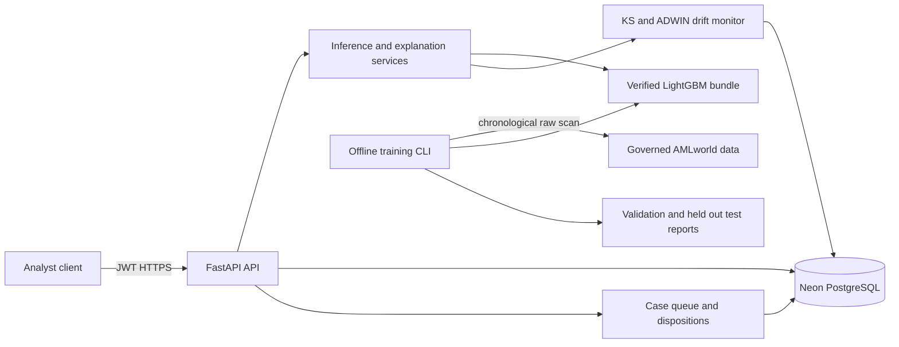

# Sprint 2 Backend Architecture

The backend is a native Python service built around FastAPI, a versioned LightGBM model bundle, and Neon PostgreSQL. It does not require Docker, Redis, or a local PostgreSQL server. Research-scale source data and chronological evaluation outputs stay in governed Parquet and JSON artifacts; Neon stores only operational application state.

## Boundaries

- `backend/app/ml` owns deterministic feature construction, model fitting, calibration, evaluation, and checksummed artifacts.
- `backend/app/services` owns inference, TreeSHAP narratives, reliability gating, case workflow rules, and drift detection.
- `backend/app/api` exposes the versioned analyst and administration routes.
- `backend/app/db` contains SQLAlchemy models, repositories, async sessions, and Alembic migrations for Neon.
- Ground-truth labels, laundering typologies, and sealed case identifiers are evaluation-only and are never represented in analyst-facing request schemas or operational tables.

## Model lifecycle

The primary model is a CPU LightGBM binary classifier. Training uses exact chronological timestamp-group splits. Every positive training row is retained; negative rows are deterministically sampled only in the training period and receive inverse-inclusion weights. Validation and test are scored in full. A sigmoid calibrator is fitted on validation scores, and the held-out test is evaluated only after all choices are frozen.

The bundle stores the LightGBM model in native text form and stores calibration, schema, metrics, configuration, and training provenance as JSON. Every payload is SHA-256 verified before loading. The optional Isolation Forest artifact uses joblib and is loaded only through the explicit trusted-local path. TreeSHAP values come from LightGBM's native contribution output.

The frozen `sprint2-lightgbm-v1` evaluation and its qualifications are recorded
in [model_card.md](model_card.md); machine-readable values live in the bundle's
`metrics.json`.

## Neon data model

Neon stores users, rotating refresh sessions, masked transactions, immutable model-version metadata, predictions, explanations, analyst cases, append-only dispositions, drift snapshots, human-gated retraining requests, and audit events. Model binaries and research matrices are referenced by URI and checksum rather than inserted into PostgreSQL.

Model registration is an explicit deployment step: `scripts/register_model.py`
re-verifies the bundle, records immutable candidate metadata, and can activate
the candidate while retiring the previous active version. Online prediction
does not create cases directly because that would bypass the fixed-capacity
study contract. A senior investigator or administrator materializes an hour at
`POST /api/v1/cases/materialize`; the service ranks active-model predictions by
score and stable event-ID tie-break, persists only the top-*N*, and is
idempotent for retries. Each case-transaction link pins the exact prediction
used at materialization, so later model promotion or rescoring cannot change
the scores or explanation presented for an existing review.

The runtime uses the pooled Neon endpoint with TLS, `pool_pre_ping`, a deliberately small application pool, and async SQLAlchemy sessions. Alembic can use an optional direct migration URL. SQLite is supported only for isolated automated tests.

## Security and operations

- Passwords use Argon2id and are never logged.
- Access JWTs are short lived and validate issuer, audience, type, role, timestamps, and JTI.
- Refresh JWTs rotate transactionally; reuse revokes the token family.
- Roles are `fraud_analyst`, `senior_investigator`, and `admin`.
- Account identifiers are masked before persistence and response serialization.
- Case views, claims, dispositions, model promotions, and retraining requests create audit records.
- Retraining is human-gated. Drift detection opens a request; it never deploys a model automatically.

## Native setup

1. Create and activate a Python 3.12 or newer virtual environment, then install `requirements-dev.txt`.
2. Copy `.env.example` to `.env`, paste the pooled Neon URL, and replace the JWT secret.
3. Run `python -m alembic upgrade head`.
4. Set `ADMIN_PASSWORD` in the current shell and run `python scripts/seed_admin.py --email admin@example.com`.
5. Train the model with `python scripts/train_sprint2.py --config config/model.json --bundle-id sprint2-lightgbm-v1`.
6. Register and activate it with `python scripts/register_model.py --bundle artifacts/models/sprint2-lightgbm --created-by admin@example.com --activate`.
7. Start the API with `python -m uvicorn backend.app.main:app --host 127.0.0.1 --port 8000`.
8. Check `/health/live`, `/health/ready`, and `/docs`.

Use a separate Neon branch and `TEST_DATABASE_URL` for live PostgreSQL integration tests. No credential or real customer data belongs in the repository.
